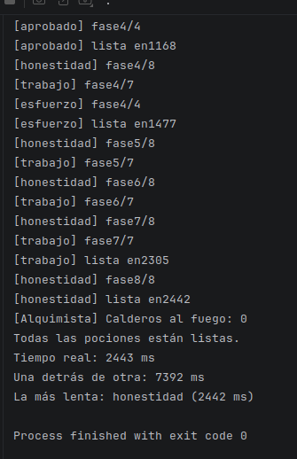
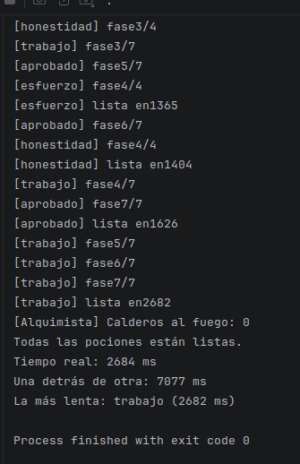
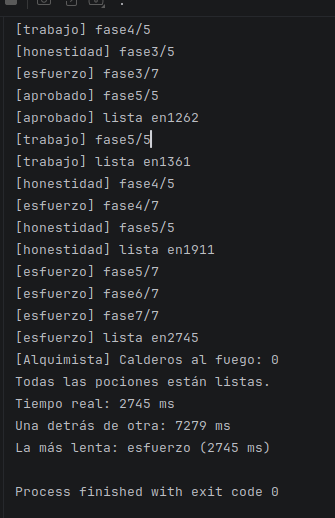

# Tarea 9b PSP

| Ejecución | Poción más lenta (fases × ms) | Tiempo real (ms) | Suma (ms) |
| :---: | :--- | :---: | :---: |
| 1 | honestidad | 2442 | 7392 |
| 2 | trabajo | 2682  | 7077 |
| 3 | esfuerzo | 2745 | 7279 |

- Primera:
- 
- Segunda:
- 
- Tercera:
- 